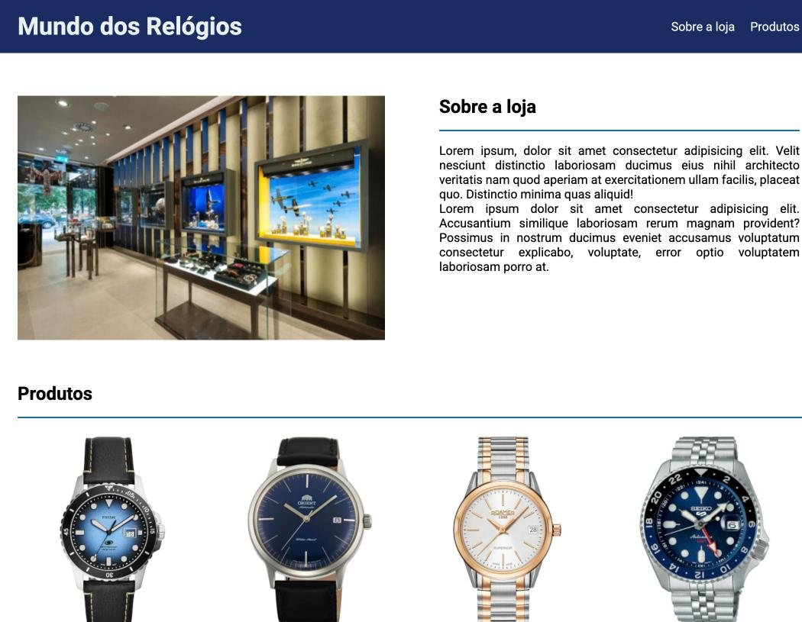
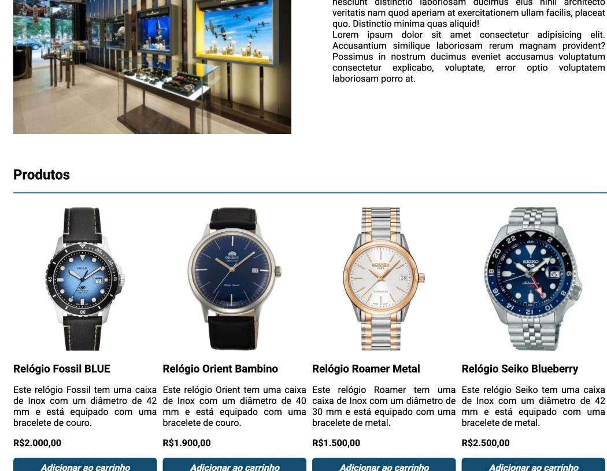

# ⌚ Mundo dos Relógios

Página de uma **loja de relógios**, com secção "Sobre a loja" e uma montra de produtos (imagem, descrição, preço e botão "Adicionar ao carrinho"). O layout é **responsivo**: adapta-se a ecrãs de telemóvel, tablet e computador.

🔗 **Demo:** [site-mundo-dos-relogios.vercel.app](https://site-mundo-dos-relogios.vercel.app)




---

## 📸 Montra de produtos



## ✨ O que pratiquei

- **CSS Grid** para a montra de produtos (4 colunas no computador, 1 no telemóvel) e para a secção "Sobre"
- **Flexbox** no cabeçalho e na navegação
- **Media queries** com três pontos de quebra: telemóvel (até 640 px), tablet (641–1023 px) e computador
- Estrutura semântica com `header`, `nav` e `section`
- Tipografia com **Google Fonts** (Roboto)
- Publicação do site na **Vercel**

## 📁 Estrutura

```
├── images/      # Fotografias da loja e dos produtos
├── index.html   # Página
└── main.css     # Estilos e media queries
```

## ▶️ Como ver

Abre o `index.html` no browser ou visita a [demo](https://site-mundo-dos-relogios.vercel.app). Para ver a versão responsiva, reduz a largura da janela.

## 📚 Contexto

Projeto desenvolvido no âmbito da formação **Full Stack Java da EBAC** (módulo de CSS responsivo), em 2023.

---

Desenvolvido por **Hanna Sampaio** · [LinkedIn](https://www.linkedin.com/in/hannasampaio7/) · [GitHub](https://github.com/hannasampaio)
